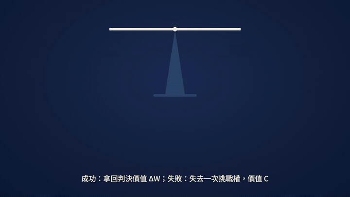

# 挑戰研究員｜中職挑戰決策門檻卡

**遇到有爭議的判決，改判的把握要多高才值得挑戰？**

答案不是五成。中職重播還剩 2 次時，門檻只有 **1–2%**；好壞球的模擬裡，固定等到五成把握才挑戰，比照球員現有挑戰習慣的基準少 **0.65 勝**（模型內的價值差，試算）。

2026 野革盃 台灣棒球數據黑客松參賽作品｜[網站](https://kuotunyu.github.io/rebas2026-when-to-challenge/)｜[互動 Demo](https://kuotunyu.github.io/rebas2026-when-to-challenge/demo/)｜[挑戰門檻計算機](https://kuotunyu.github.io/rebas2026-when-to-challenge/calculator/)｜[門檻卡 A6 列印版](https://kuotunyu.github.io/rebas2026-when-to-challenge/card/)



## 門檻

```text
門檻 p* ＝ 挑戰權價值 C ÷（判決價值 ΔW ＋ 挑戰權價值 C）
```

開賽平手、還剩 2 次時，失去一次挑戰權只值 **0.112** 個勝率百分點，一次壘上判決平均值 **5.77**，約是它的五十倍。只剩 1 次時，門檻從一局 13% 逐局降到九局 2%。

| 中職重播 | 1 局 | 2 局 | 3 局 | 4 局 | 5 局 | 6 局 | 7 局 | 8 局 | 9 局 |
|---|---:|---:|---:|---:|---:|---:|---:|---:|---:|
| **還剩 2 次** | 2% | 2% | 1% | 1% | 1% | 1% | 1% | 1% | 1% |
| **只剩 1 次** | 13% | 13% | 11% | 10% | 9% | 7% | 6% | 4% | 2% |

## 方法與檢驗

- **勝率模型**：中職 2023–2026 例行賽 **1,362 場、390,489 顆投球**。直接計次的表，1,075 組相鄰局面有 205 組「多領先 1 分，勝率反而較低」；改用兩段拆解法後，1,224 組只剩 2 組。留一年交叉驗證：校準斜率 **0.97**（95% 區間 0.94–0.99），Brier 分數 **0.157**（只猜平均勝率是 0.250）。
- **挑戰權價值**：從九局結束往回推的動態規劃，18 個半局 × 17 種分差 × 剩幾次。用 2024-05-28 改制後 **968 場、1,097 次挑戰**調整；改制前中間三期 **1,492 場**不拿來調，只用來比對：規則越寬，實際和模型都是挑戰變多、翻盤率變低。
- **重播卡 18 格**：用 **26,279 個**實際壘上判決檢驗，在兩種平均把握的假設下，照卡片挑戰能拿回逐一計算門檻時的 **98.8%–100.0%**（還剩 2 次）和 **91.4%–98.7%**（只剩 1 次）。
- **好壞球卡 108 格（跨聯盟試算）**：中職一軍尚未實施，用 MLB 2026 整季 **354,722 顆**合資格判決球，套中職的勝率模型。每隊一季 120 場、含延長賽，和照球員現有挑戰習慣的基準比（模型內的價值差）：照 108 格卡 **+0.29 勝**（0.26～0.31），「把握過半才挑戰」**−0.65 勝**（−0.69～−0.60）。

## 成品

決策沙盤（選局面即時查門檻）、挑戰門檻計算機（任何判決填兩個勝率就能算）、A6 雙面門檻卡（手機上可用大字表格查）。門檻卡和主要數字都由程式和提案逐格核對。

## 限制與資料

- 卡片還沒有在現場測試過；把握要靠人判斷。好壞球是試算，中職實施後要用中職資料重做。勝場數字是模型內的價值差，不是實際戰績。
- 資料：野球革命 rebas.tw Open Data（ODC-By）、中職官網文字轉播的統計、MLB StatsAPI、WhartonSABI 開源資料。本 repo 只含網頁、統計量和模型輸出表，不含逐球原始資料；不是主辦單位或中華職棒的官方產品。
